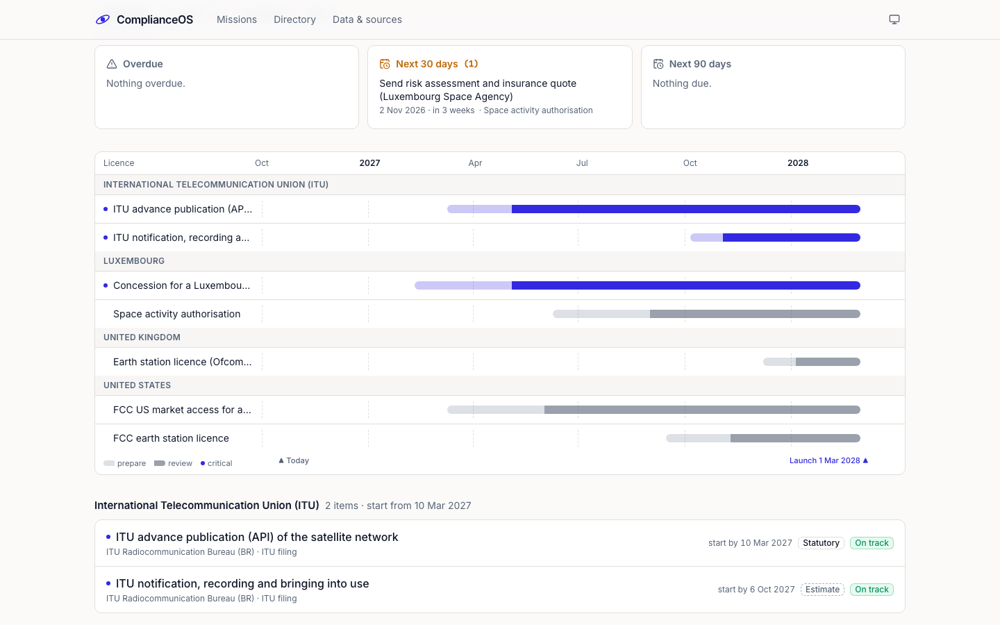
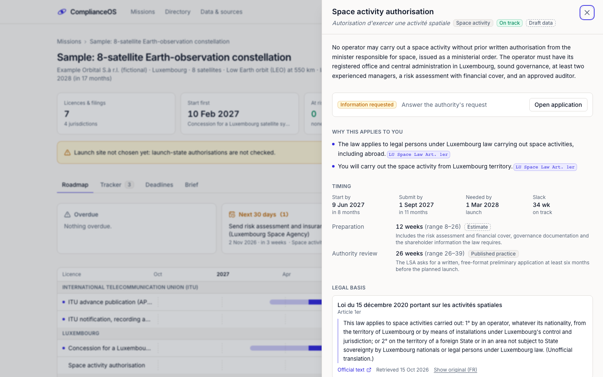
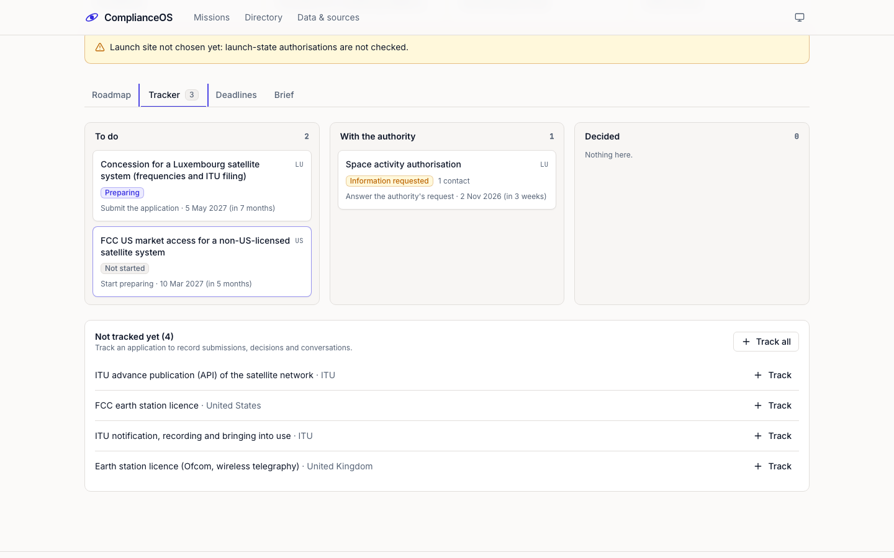
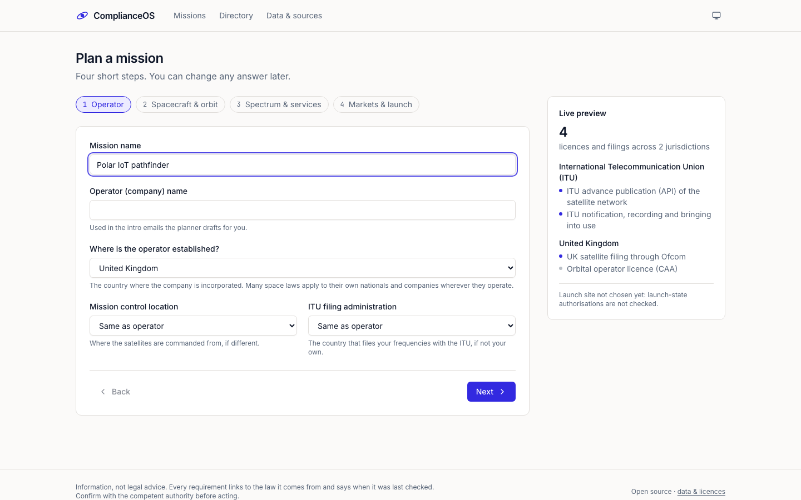
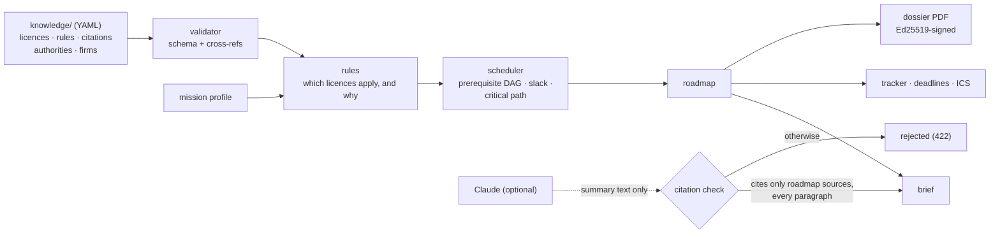

# ComplianceOS

**Open-source licensing roadmaps for satellite missions.**

Describe your mission once, whether one cubesat or a constellation. ComplianceOS shows every licence,
authorisation and ITU filing it needs in each country. Each requirement says why it applies to your
mission and quotes the law it comes from. Work starts are dated back from your launch date, the
critical path is highlighted, and the planner points you to the right authority and to firms that
can help. Then you track each application through to approval, so no deadline or renewal slips.

It is built so that operators of any size, in any country, can plan their regulatory path with the
same clarity as teams that have a regulatory department.



> **Information, not legal advice.** Every requirement links to the law it comes from and says
> when it was last checked. Confirm with the competent authority before acting.

## Quickstart

You need Docker.

```bash
git clone <this repository> complianceos && cd complianceos
docker compose up --build
```

Open <http://localhost:3000> and choose **Open the sample mission**. The first build compiles the
database's graph extension and takes a few minutes. If it stops while downloading packages, run the
command again.

Optional settings (dossier signing, Claude-written summaries) are listed in
[`.env.example`](.env.example). Nothing leaves your machine unless you add an API key.

## What it does

| | |
|---|---|
| **Roadmap** | Every licence, authorisation and filing for your mission, grouped by country. Each shows why it applies, the authority, documents, fees, local-presence requirements and the obligations that follow (renewals, milestones, reports). |
| **Cited law** | Each requirement cites the article it rests on: an excerpt quoted verbatim, an English rendering when the original isn't English, a link to the official text, and the date it was checked. |
| **Timeline** | Preparation and review time for each item, worked back from your launch date through prerequisites (for example, the ITU publication before notification). It shows the critical path, what's late, and what has slack. Every duration says whether it is set in law, published practice, or an estimate. |
| **Tracker** | Applications move through an explicit state machine. Submission and grant dates re-date the obligations that depend on them. A conversation log keeps next steps with due dates. Everything exports to your calendar (ICS). |
| **Contacts & help** | The authorities' own published contact channels, a drafted first email to each authority or firm, and a neutral directory of licensing firms. |
| **Brief & dossier** | A regulatory brief (summary, critical path, risks, sequence, questions to ask each authority) and a PDF dossier. Dossiers carry an Ed25519 signature when a key is configured. |

| Licence detail, with quoted law | Tracking applications |
|---|---|
|  |  |



## Coverage

The data lives in [`knowledge/`](knowledge/README.md) as reviewable YAML and is open to
contributions.

| Jurisdiction | What's modelled |
|---|---|
| ITU | Advance publication, coordination request, notification and bringing into use, the 7-year limit, Resolution 35 milestones for constellations |
| France | Space operations authorisation (LOS), ANFR satellite frequency filing, ministerial authorisation to operate frequency assignments |
| Luxembourg | Space activity authorisation (2020 law), satellite system concession |
| United Kingdom | Orbital operator licence (CAA, SIA 2018 / OSA 1986), Ofcom satellite filing, earth station licence |
| United States | FCC Part 25 space station licence and streamlined small-satellite route, US market access, earth station licence, NOAA remote sensing licence |

All records are `draft`: each was researched from official sources and its quotes checked against
the text, and none has yet been reviewed by a licensing practitioner.
[`knowledge/VERIFICATION.md`](knowledge/VERIFICATION.md) says how each part was checked and what
still needs a human. Countries in your mission that have no data are named in your roadmap's
warnings rather than skipped.

## How it works



- **Deterministic core.** Which licences apply is decided by small declarative rules. Order and dates
  come from a forward and a backward pass over the prerequisite graph, which property-based tests
  check over random graphs. The same mission on the same day always gives the same roadmap.
- **The model never decides.** The optional Claude summary may only cite sources already in the
  roadmap, and must cite in every paragraph, or it is rejected. The same check guards the
  compliance-drafting endpoint.
- **Local by default.** One `docker compose up` runs everything on your machine with no login. A
  multi-user "team mode" (theopenlane + OpenFGA + Dex) is in [`cross-cutting/deploy/`](cross-cutting/deploy/).
- **Sovereign by design.** Self-hostable end to end, with self-hosted fonts and Next.js telemetry
  disabled in the images. Nothing calls a third party unless you configure an LLM key.

Design decisions are recorded as ADRs in [`adr/`](adr/); start with
[ADR-0018](adr/0018-regulatory-path-planner.md). The product and visual principles are in
[`DESIGN.md`](DESIGN.md), and the trust layer's threat model is in
[`docs/THREAT_MODEL.md`](docs/THREAT_MODEL.md).

## Development

```bash
# API (Python 3.12, FastAPI)
cd app && uv sync
uv run uvicorn app.main:app --port 8001     # in-memory store if no Postgres is reachable
uv run ruff check . && uv run mypy app && uv run pytest
uv run python -m app.planner.knowledge validate

# Web (Next.js 14, TypeScript)
cd web && bun install
bun run dev                                  # http://localhost:3000
bun run typecheck && bun run lint && bun test && bun run build
```

CI runs all of these, plus the Postgres store contract, a secret scan and a weekly check that
every cited URL still answers.

```
app/           planner API, rules, scheduler, tracker, exports (FastAPI)
web/           web app (Next.js)
knowledge/     the open licensing dataset (CC BY 4.0)
adr/           architecture decision records
layers/        platform layers: substrate, knowledge graph, orbital mechanics, dashboards
cross-cutting/ team-mode deployment, auth model
```

## Contributing

Corrections and new jurisdictions are the most useful contributions, and reviews by licensing
practitioners are especially welcome. See [CONTRIBUTING.md](CONTRIBUTING.md). Please report
security issues privately ([SECURITY.md](SECURITY.md)).

## Licence

Code: [Apache-2.0](LICENSE). Data in `knowledge/`: [CC BY 4.0](knowledge/LICENSE.md); quoted legal
excerpts keep their publishers' terms. Maintained by Tidelink and contributors.
