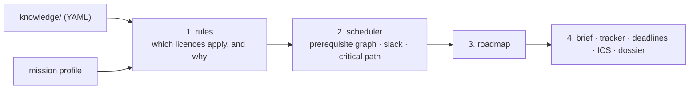

# Architecture

This page explains how the planner turns a mission into a roadmap, and why the parts are separated the
way they are. The complete component map and the older platform layers are in
[`ARCHITECTURE.md`](../../ARCHITECTURE.md).

## The problem

An operator planning a satellite mission needs to know which licences and filings each country
requires, why each one applies, in what order they must happen, and by when. Getting any of those
wrong costs time, money or the mission.

The answer depends on rules that are public but scattered, change over time, and need to be checked
against their sources. So the planner keeps the knowledge as reviewable data and keeps the calculation
deterministic.

## The pipeline

A mission profile goes through four deterministic stages.

1. **Rules** evaluate each licence's `applies_when` against the profile. Each match records the
   reason and the citation that supports it.
2. **The scheduler** works over the prerequisite graph. A forward pass gives the earliest dates; a
   backward pass from the launch date gives the latest. The difference is slack. Items with no slack
   form the critical path.
3. **The roadmap** is the assembled result: items, dates, authorities, warnings for countries with no
   data.
4. **Outputs** are built from the roadmap: the brief, the tracker, deadlines, the calendar export, and
   the PDF dossier.

Because each stage is a function of its inputs, the same mission on the same day gives the same
roadmap. Property-based tests check the scheduler over random graphs.

## Where the model is allowed to act

A language model is optional, and it never decides anything in the pipeline. It can only write the
brief's executive summary, and its text is checked: every paragraph must cite a source that is already
in the roadmap. A summary that fails the check is rejected. See
[why every requirement cites the law](why-cited-law.md).

## Local and team modes

- **Local (default).** One `docker compose up` runs the stack on your machine with no login. The API
  binds to loopback.
- **Team.** A multi-user mode uses theopenlane for identity and OpenFGA for authorisation, described in
  [`cross-cutting/deploy/`](../../cross-cutting/deploy/).

The planner code is the same in both modes. Only the access layer changes.

## Storage

Missions, applications and contact logs are stored in Postgres. If no Postgres is reachable, the API
uses an in-memory store, which is enough for exploring but loses data on restart.

## Why it is structured this way

- **Data outside the code.** A new country is a new set of YAML files, reviewed like any other change,
  not a code change.
- **Calculation separate from presentation.** The API returns the roadmap as data; the web app and the
  PDF are two views of it.
- **Substrates over rewrites.** The earlier platform layers (knowledge graph, orbital mechanics,
  dashboards) remain in the repository. They are described in
  [the earlier architecture](earlier-architecture.md) and are not part of the planner.

Decisions behind these choices are indexed in [decisions](decisions.md); start with
[ADR-0018](../../adr/0018-regulatory-path-planner.md).
